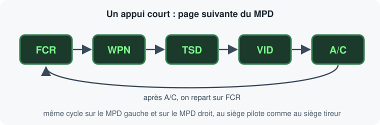
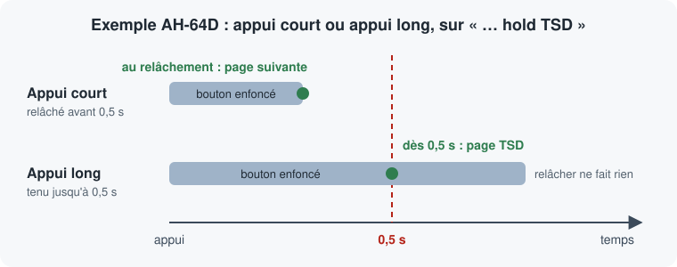

# DCS cockpit mods

**Apache MPD cycles** : sur l'AH-64D de DCS World, un seul bouton du HOTAS fait défiler les pages d'un MPD, et un appui long va directement sur la page de ton choix.
Plus besoin d'un bouton par page, ni de lâcher le manche pour cliquer sur l'écran.

Ce dépôt contient aussi **l'accroche des mods de cockpit**, un petit paquet qui permet à plusieurs mods de cockpit de s'installer ensemble (ce mod-ci, le [rideau IFR](https://github.com/davidp57/dcs-ifr-curtain)…).

## Ce que ça fait

Chaque MPD (gauche et droit) a son propre bouton.
Un appui court affiche la page suivante :



Ce sont toutes les pages qui ont leur propre bouton autour de l'écran, sauf COM.

Un appui long (bouton tenu une demi-seconde) va directement sur une page, sans passer par les autres.
Cette page, tu la choisis une fois pour toutes en assignant la bonne commande dans DCS (voir plus bas) : FCR, WPN, TSD ou VID.



Le mod marche aux deux sièges : les boutons du pilote changent les MPD du pilote, ceux du tireur les MPD du tireur.

## Installer

Il faut [Open Mod Manager](https://github.com/iquercorb/OpenModMan), configuré pour DCS avec deux canaux : « Game files » (le dossier de DCS World) et « User files » (`Saved Games\DCS`).

### 1. Récupérer les paquets

| Paquet | Où le trouver | Canal |
|---|---|---|
| `Cockpit_Mods_Hook_v<version>.ozp` | [page Releases de ce dépôt](https://github.com/davidp57/dcs-cockpit-mods/releases) | Game files |
| `Apache_MPD_Cycles_v<version>.ozp` | [page Releases de ce dépôt](https://github.com/davidp57/dcs-cockpit-mods/releases) | Game files |
| `Quaggles_Injector` | [Quaggles' DCS Input Command Injector](https://github.com/Quaggles/dcs-input-command-injector) | Game files |
| `Custom_Keybinds`, version du 2026-11-14 ou plus récente | commandes de [dcs-community-keybinds](https://github.com/davidp57/dcs-community-keybinds) | User files |

Les deux premiers sont ce mod.
L'injecteur de Quaggles permet d'ajouter des commandes à DCS sans toucher aux fichiers des modules ; Custom_Keybinds contient les commandes elles-mêmes (catégorie « MPD page cycles » de l'Apache), avec beaucoup d'autres commandes de la communauté.

### 2. Les installer

1. Ferme DCS.
2. Si tu as le rideau IFR en version 1.x (paquet `IFR_Curtain_v1.x`), désinstalle-le d'abord : il remplace le même fichier de DCS que l'accroche. Sa version 2.0 passe par l'accroche, et s'installe après elle.
3. Dans Open Mod Manager, installe les quatre paquets, chacun dans son canal.
4. Lance DCS.

### 3. Assigner les boutons

1. Lance une mission en AH-64D.
2. Échap > **Options** > **Commandes**.
3. En haut, choisis **AH-64D Pilot** (ou **AH-64D CP/G** pour le siège tireur : les deux profils sont séparés, il faut assigner dans chacun).
4. Dans la liste des catégories, choisis **MPD page cycles**.
5. Assigne **une** commande au bouton du HOTAS du MPD gauche, et **une** au bouton du MPD droit, selon ce que tu veux faire de l'appui long :

| Commande | Appui court | Appui long |
|---|---|---|
| Left MPD: next page | page suivante, dès l'appui | rien |
| Left MPD: next page, hold FCR | page suivante, au relâchement | page FCR |
| Left MPD: next page, hold WPN | page suivante, au relâchement | page WPN |
| Left MPD: next page, hold TSD | page suivante, au relâchement | page TSD |
| Left MPD: next page, hold VID | page suivante, au relâchement | page VID |

Même chose avec « Right MPD » pour le MPD droit.

Avec un appui long, la page suivante ne s'affiche qu'au relâchement du bouton : le mod doit attendre de savoir si tu le tiens.
Si tu ne veux pas d'appui long, prends « next page » : la page change dès que tu appuies.

### Après une mise à jour de DCS

Une mise à jour ou une réparation de DCS remet d'origine le fichier que l'accroche modifie : le mod ne fait plus rien.
Désinstalle puis réinstalle `Cockpit_Mods_Hook` dans Open Mod Manager.
Si la mise à jour a changé ce fichier, il faut une nouvelle version du paquet : regarde la page Releases.

## Bon à savoir

- **Multijoueur** : le mod modifie des scripts de DCS, donc la vérification d'intégrité (IC) échoue. Il marche en solo et sur les serveurs qui ne vérifient pas les scripts.
- **Le mod ne voit pas tes clics à la souris** : il retient seulement la dernière page qu'il a lui-même affichée. Après un changement de page à la souris, l'appui suivant peut donner une page inattendue ; le cycle se recale au tour suivant.
- **Un appui long sur une page du cycle y replace le cycle** : après un appui long sur TSD, l'appui court suivant donne VID.
- **Ce que fait chaque appui est écrit dans `Saved Games\DCS\Logs\dcs.log`**, lignes `COCKPIT_CYCLES` : c'est là qu'il faut regarder si un bouton ne fait rien.

## Pour les développeurs

### L'accroche partagée

Un mod de cockpit déclare ses équipements (un `avLuaDevice`, un écran) dans le `device_init.lua` du module.
Le seul point d'entrée commun à la plupart des modules est `Scripts\Aircrafts\_Common\Cockpit\KNEEBOARD\declare_kneeboard_device.lua`, chargé par leur `device_init.lua`.
Open Mod Manager ne sait que remplacer des fichiers entiers, et un seul paquet peut remplacer un même fichier : deux mods qui ajoutent chacun leur ligne au fichier du kneeboard sont en conflit.

L'accroche (`hook/`) est ce seul paquet.
Elle ajoute une ligne au fichier du kneeboard, qui exécute `COCKPIT_MODS\_loader.lua` ; celui-ci exécute chaque fichier du dossier `COCKPIT_MODS`, un par mod (`IFR_CURTAIN.lua`, `COCKPIT_CYCLES.lua`…).
Chaque mod décide lui-même s'il concerne l'avion chargé.
Un mod qui échoue est écrit dans `dcs.log` et n'empêche pas les autres de se charger ; la ligne du kneeboard est protégée de la même façon, pour qu'une accroche cassée ne prive pas le module de ses autres équipements.

Pour lister le dossier, l'accroche a besoin de `lfs`.
Aucun `device_init.lua` d'ED ne s'en sert, mais il y est disponible (vérifié en jeu le 2026-11-14).
Par prudence, l'accroche l'essaie à l'exécution :

| `lfs` dans `device_init.lua` | L'accroche charge |
|---|---|
| disponible | tous les fichiers `.lua` du dossier, par ordre alphabétique, sauf ceux qui commencent par `_` |
| indisponible | les mods connus, liste `KNOWN_MODS` de `_loader.lua` ; un fichier absent est sauté |

Le cas retenu et chaque mod chargé sont écrits dans `dcs.log`, lignes `COCKPIT_MODS`.

Identifiants d'équipement pris par les mods : 250 pour le rideau, 251 pour les cycles.
Chaque mod s'abstient si le sien est déjà pris dans l'avion.

### Les cycles

Le mod (`cycles/`) est un équipement Lua (`avLuaDevice`, numéro 251) qui reçoit des « slots » : 40 au plus, chacun avec une commande touche enfoncée (3000 + n) et une commande touche relâchée (3100 + n), ce qui permet de mesurer la durée de l'appui.
`COCKPIT_CYCLES\config\AH-64D.lua` donne à chaque slot une action courte et une action longue : appuyer sur le bouton suivant d'un cycle, ou toujours sur le même bouton (puis le relâcher 0,1 s plus tard), comme le ferait un clic de souris (`performClickableAction`).
Les slots d'un même MPD partagent la position de leur cycle.

Aucune fonction Lua du cockpit ne dit quel siège est occupé (aucune trouvée dans les scripts de DCS le 2026-11-14).
Les commandes du tireur ont donc leurs propres numéros, envoyés par les fichiers de commandes du tireur, et c'est à ce numéro que le mod reconnaît le siège :

| Siège | MPD gauche | MPD droit |
|---|---|---|
| pilote | slots 1 à 5 | slots 8 à 12 |
| tireur | slots 21 à 25 | slots 28 à 32 |

Dans chaque MPD : « next page », puis « hold FCR », « WPN », « TSD », « VID ».
Ces numéros ne doivent jamais changer : DCS enregistre les assignations des pilotes sous le numéro de la commande, et une renumérotation les ferait pointer ailleurs sans prévenir.
Les slots 6, 7, 13 et 14 (appuis longs COM et A/C, retirés) restent libres pour cette raison.

Réglages du fichier de configuration : `long_press` (seuil de l'appui long, en secondes), `release_after` (délai avant de relâcher le bouton du cockpit), `show_messages` (`true` affiche aussi chaque appui à l'écran, utile pour régler un nouvel avion).

Le mécanisme ne dépend pas de l'Apache.
Pour un autre avion (un F-16, par exemple), on ajouterait une ligne à `COCKPIT_CYCLES\aircraft.lua`, un `config\<avion>.lua` sur le modèle de celui de l'Apache (boutons trouvés dans `Mods\aircraft\<avion>\Cockpit\Scripts\clickabledata.lua`), et ses commandes dans dcs-community-keybinds.

### Construire les paquets

Dans `dist\` :

```powershell
python "D:\dev\_dcs-other\dcs-cockpit-mods\tools\build_omm.py" hook 1.0.0 "C:\jeux\DCS World"
```

```powershell
python "D:\dev\_dcs-other\dcs-cockpit-mods\tools\build_omm.py" cycles 1.0.0
```

Le paquet de l'accroche contient une copie complète du fichier du kneeboard avec la ligne ajoutée, prise sur la version de DCS installée au moment de construire le paquet (sans les lignes d'une installation de développement) : le reconstruire après une mise à jour de DCS qui modifie ce fichier.

### Installation de développement

Pour modifier les mods et les essayer sans repasser par Open Mod Manager (ne pas installer les paquets en même temps) :

```powershell
& "D:\dev\_dcs-other\dcs-cockpit-mods\install.ps1"
```

```powershell
& "D:\dev\_dcs-other\dcs-cockpit-mods\install.ps1" -Uninstall
```

`-Part Hook` ou `-Part Cycles` pour n'en traiter qu'un ; `-DcsPath "D:\DCS World"` pour une autre installation de DCS.

Le script copie les fichiers et ajoute la ligne de l'accroche au fichier du kneeboard, entre `-- COCKPIT-MODS BEGIN` et `-- COCKPIT-MODS END`.
Le fichier est sauvegardé en `.cockpit-mods.bak` avant la modification, sauvegarde reprise chaque fois qu'il est trouvé sans l'accroche (après une mise à jour de DCS, par exemple).
La désinstallation le rend identique à l'original et supprime la sauvegarde ; un fichier qui n'est pas en UTF-8 valide est refusé plutôt que réécrit.
Sans cette sauvegarde, l'accroche vient sans doute du paquet Open Mod Manager : la désinstallation refuse d'y toucher, sauf avec `-Force`.
`-Part Cycles` refuse de s'installer si l'accroche manque, chargeur ou ligne du kneeboard (une mise à jour de DCS retire la ligne et laisse le chargeur).
L'accroche refuse de s'installer par-dessus la ligne d'un rideau IFR 1.x : le retirer d'abord (paquet dans Open Mod Manager, ou `install.ps1 -Uninstall` du rideau).

Les commandes ne sont pas installées par ce script : elles viennent de Custom_Keybinds.

Relancer le script après chaque modification, puis relancer la mission : les scripts du cockpit sont relus à chaque démarrage de mission, sans redémarrer DCS.

### Vérification hors jeu

`tests\run.ps1` exécute l'accroche et les cycles de l'AH-64D avec un Lua 5.1 ordinaire et des fonctions de DCS simulées, une fois avec `lfs` et une fois sans : chargement par l'accroche, cycle des appuis courts, appuis longs, sièges pilote et tireur, relâchement des boutons.
Il demande le Lua 5.1 de ZeroBrane Studio (`-Lua` pour un autre) et les scripts de l'AH-64D d'une installation de DCS.

```powershell
& "D:\dev\_dcs-other\dcs-cockpit-mods\tests\run.ps1"
```

Il ne dit rien de ce que DCS accepte vraiment, qui se vérifie en jeu.
Vérifié en jeu le 2026-11-14 : `lfs` est disponible dans `device_init.lua`, et les cycles marchent aux deux sièges.
